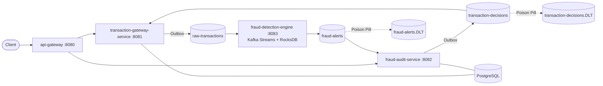

# Financial Fraud Detection Pipeline

An event-driven microservices pipeline for real-time payment fraud detection, built with **Java 21**, **Spring Boot 4**, **Kafka Streams**, **PostgreSQL**, and a **PLG (Prometheus, Loki, Grafana)** observability stack.

## Architecture



## Key Design Highlights

- Reliable Event Delivery: Dual-service Transactional Outbox pattern (transaction_outbox and audit_outbox) guarantees atomic DB writes and at-least-once Kafka publishing.

- Stateful Stream Processing: Kafka Streams backed by RocksDB WindowStore evaluates 60-second tumbling-window account velocity bursts and high-value thresholds in real time.

- Fault Isolation: Downstream consumers use ErrorHandlingDeserializer and DefaultErrorHandler with bounded retries before routing poison pills to .DLT topics.

- Human-in-the-Loop Overrides: Flagged transactions (HELD_FOR_REVIEW) can be audited and overridden (OVERRIDDEN_APPROVED / OVERRIDDEN_DECLINED), propagating final state back to the gateway.

- Observability: Containerized Prometheus, Promtail, Loki, and auto-provisioned Grafana dashboards for metrics and structured JSON log tracing.

## Quickstart

- Start infrastructure (PostgreSQL, Kafka KRaft, PLG):

    ```Bash
    docker compose -f docker-compose.infra.yml up -d
    ```

- Build and start microservices:

    ```Bash
    docker compose -f docker-compose.app.yml up --build -d
    ```

- Access endpoints:

    ```
    API Gateway: http://localhost:8080/swagger-ui/index.html

    Grafana (admin / admin): http://localhost:3000

    Prometheus: http://localhost:9090
    ```
